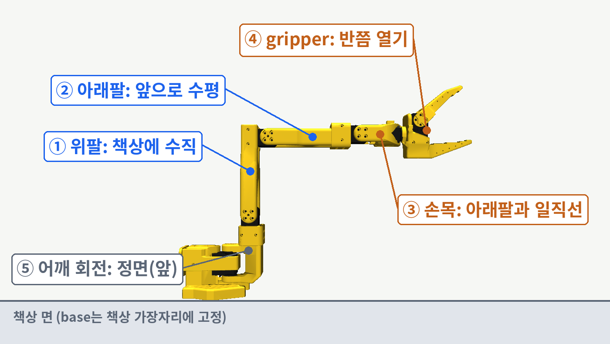
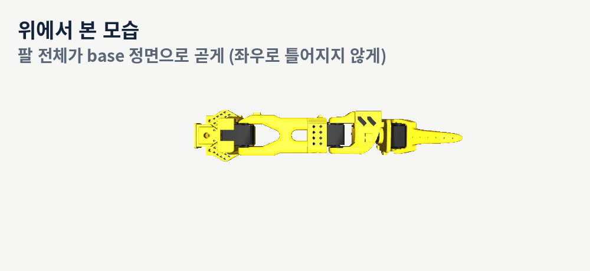
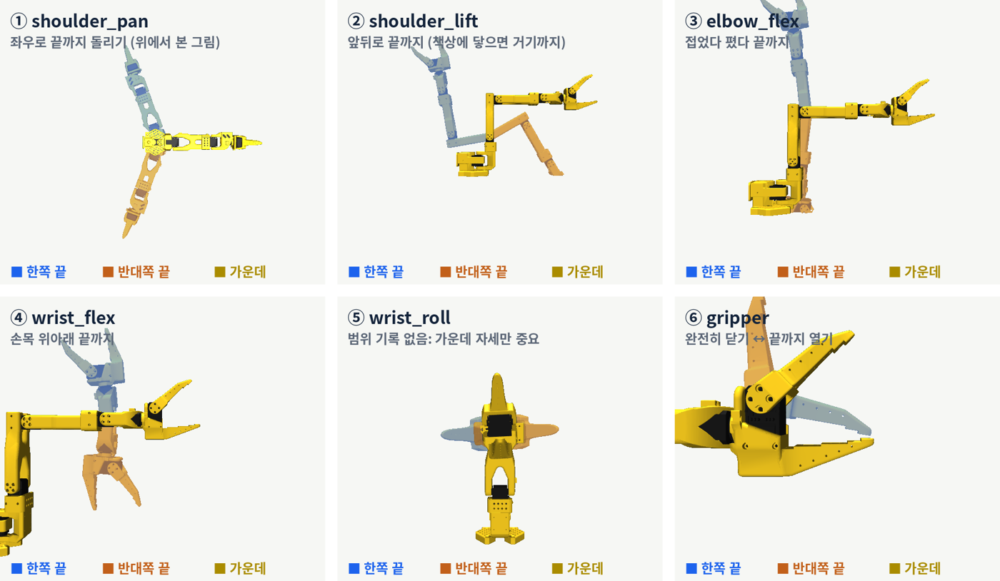
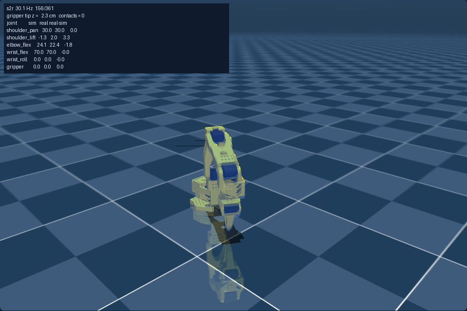
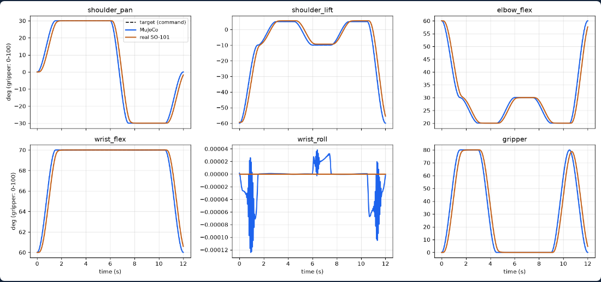
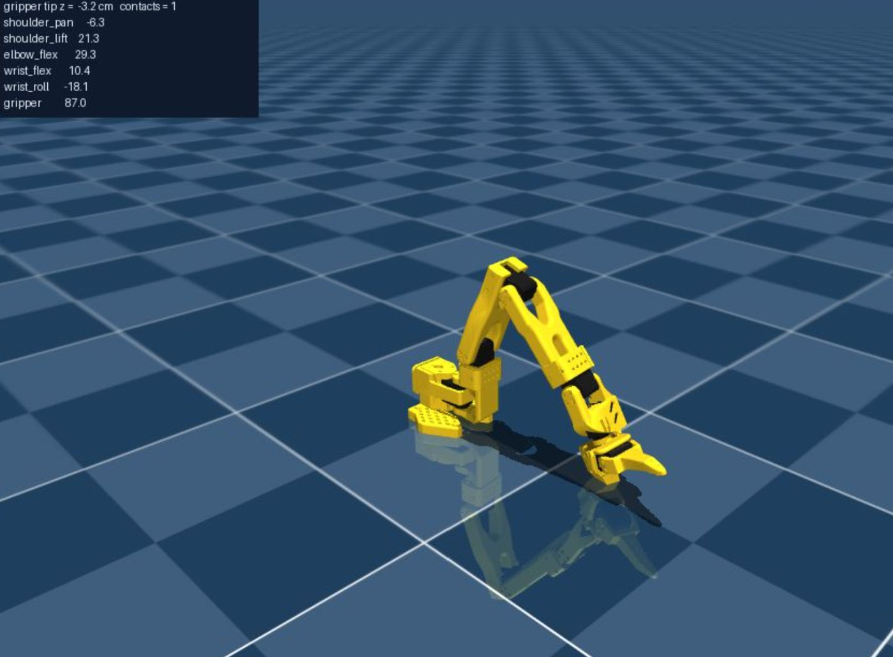
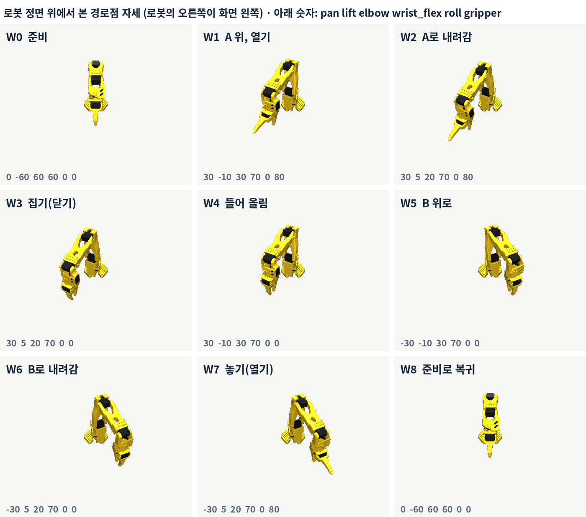

# 11주차 · LeRobot SO-ARM101 실습 (Jetson Orin NX)

MuJoCo sim-to-real → teleoperation·데이터 녹화 → ACT → Diffusion Policy.
강의 슬라이드: **SO-ARM101 LeRobot 실습** (claude.ai Slides, 58장).

| 장비 | 값 |
|---|---|
| 로봇 | SO-ARM101 leader + follower (STS3215 servo), USB 카메라 2대(front, wrist) |
| 컴퓨터 | NVIDIA Jetson Orin NX 16GB, JetPack 6.2 (L4T R36.4.4, CUDA 12.6), 전원 모드 MAXN |
| 소프트웨어 | LeRobot v0.7.0 (Python 3.12) — Docker image `ghcr.io/ravediamond/lerobot-jetson:0.7.0-jp6.2` (mujoco 3.8.1 포함) |

## 0. 두 가지 실습 방식

| | **A · Jetson에 모니터·키보드 직접 연결** | **B · PC에서 ssh 접속 (모니터 없음)** |
|---|---|---|
| 명령 입력 | Jetson 바탕화면 터미널 | PC 터미널에서 `ssh lerobot@<Jetson IP>` |
| container 만들기 | `bash scripts/run_container.sh a` (xhost 허용 포함) | `bash scripts/run_container.sh b` |
| MuJoCo 화면 | viewer 창 (Jetson 모니터) | `twin_web.py` → PC 브라우저 `http://<Jetson IP>:8000` |
| Part 1 실행 | fk_check · sim_run --viewer · real_run · compare · twin.py | fk_check · real_run --step + **twin_web.py** (pose / sim / s2r / twin) |
| 비교 그래프 | Jetson에서 compare.png 열기 | 브라우저 결과 영역에 자동 표시 |
| 녹화·실행 화면 | `--display_data=true` (Rerun 창) | `--display_data=false` |
| 녹화 키 | → 저장 · ← 다시 · ESC 종료 | **n** 저장 · **r** 다시 · **q** 종료 (ssh 터미널, Enter 없이) |

로봇 연결(USB), container, calibration, 학습 명령은 A·B 모두 같습니다. 다른 것은 화면을 어디서 보느냐뿐입니다.

터미널 표시: **H** = Jetson 본체(container 밖), **C** = container 안(프롬프트 `root@…:/opt/lerobot#`).

## LAB 0 · 준비

```bash
# H: image 받기 (약 28 GB, 수업 전에 조교가)
docker pull ghcr.io/ravediamond/lerobot-jetson:0.7.0-jp6.2
# H: 강의 repo 받기 — 폴더가 없으면 clone, 있으면 pull
if [ -d ~/airobotics_ws ]; then cd ~/airobotics_ws && git pull
else git clone https://github.com/bgloh/airobotics_ws.git ~/airobotics_ws; fi
# H: 실습 폴더 준비 (MuJoCo 모델 + 실습 코드 → ~/so101_lab, 기존 파일은 덮어쓰지 않음)
bash ~/airobotics_ws/lerobot_so101/scripts/setup_lab.sh
ls ~/so101_lab/sim
# H: 환경 점검 (선택) → jetson_check.txt
bash ~/airobotics_ws/lerobot_so101/scripts/jetson_check.sh
# H: container 만들기·들어가기 (A 또는 B)
bash ~/airobotics_ws/lerobot_so101/scripts/run_container.sh a     # 또는 b
# 터미널을 하나 더: docker exec -it lerobot bash
```

port 찾기와 calibration (C):

```bash
lerobot-find-port          # USB를 뽑았다 꽂으며 follower·leader port 확인 (예: ACM0, ACM1)
lerobot-calibrate --robot.type=so101_follower --robot.port=/dev/ttyACM0 --robot.id=follower_g1
lerobot-calibrate --teleop.type=so101_leader  --teleop.port=/dev/ttyACM1 --teleop.id=leader_g1
```

| 가운데 자세 (옆) | 가운데 자세 (위) | 범위 기록 |
|---|---|---|
|  |  |  |

- 가운데 자세에서 Enter → 모든 관절(wrist_roll 제외)을 끝에서 끝까지 천천히 → Enter.
- 다시 calibration할 때 기존 파일을 쓰겠냐고 물으면 **영어 입력 상태로 `c`** 를 입력합니다(한글 `ㅊ`이면 기존 파일을 다시 씀).
- calibration 파일: `~/.cache/huggingface/lerobot/calibration/{robots,teleoperators}/so101_*/<id>.json`

## Part 1 · MuJoCo sim-to-real (`sim/`)

C 터미널에서:

```bash
cd /root/so101_lab/sim
export SCENE=/root/so101_lab/SO-ARM100/Simulation/SO101/scene.xml
```

### A 방식 (Jetson 모니터)

```bash
python -m mujoco.viewer --mjcf=$SCENE                                        # LAB 1-1 모델 보기
python fk_check.py --scene $SCENE 0 -60 60 60 0 0                            # LAB 1-1 FK → [0.193 0. 0.06]
python sim_run.py  --scene $SCENE --seg-time 3.0 --out sim_log.csv --viewer  # LAB 1-2
python compare.py  --sim sim_log.csv --png sim_only.png
python real_run.py --step --port /dev/ttyACM0 --id follower_g1               # LAB 1-3 경로점 하나씩 (처음엔 반드시)
python real_run.py --port /dev/ttyACM0 --id follower_g1 --seg-time 3.0       # 전체 궤적 → real_log.csv
python compare.py  --sim sim_log.csv --real real_log.csv                     # → compare.png
python twin.py --scene $SCENE --leader-port /dev/ttyACM1 --leader-id leader_g1 \
  --follower-port /dev/ttyACM0 --follower-id follower_g1                     # LAB 1-4 디지털 트윈
```

### B 방식 (ssh + 브라우저, `twin_web.py`)

```bash
export MUJOCO_GL=egl
python twin_web.py --scene $SCENE --pose 0 0 0 0 0 0                          # LAB 1-1 자세 보기 (slider)
python fk_check.py --scene $SCENE 0 -60 60 60 0 0                             # LAB 1-1 FK (화면 불필요)
python twin_web.py --scene $SCENE --traj --seg-time 3.0                       # LAB 1-2 시뮬레이션 (페이지의 시작 버튼)
python real_run.py --step --port /dev/ttyACM0 --id follower_g1                # LAB 1-3 경로점 하나씩
python twin_web.py --scene $SCENE --traj --seg-time 3.0 \
  --follower-port /dev/ttyACM0 --follower-id follower_g1                      # LAB 1-3 sim+real 동시 실행, 겹쳐 보기, 비교
python twin_web.py --scene $SCENE --leader-port /dev/ttyACM1 --leader-id leader_g1 \
  --follower-port /dev/ttyACM0 --follower-id follower_g1                      # LAB 1-4 디지털 트윈
python twin_web.py --scene $SCENE --traj --fake                               # 팔 없이 시험 (가상 follower)
```

PC 브라우저: `http://<Jetson IP>:8000` (ssh 로그인 메시지의 `from …` 주소는 PC 주소이므로 쓰지 않음).
안 열리면 Jetson에서 `sudo ufw allow 8000/tcp`, 또는 PC에서 `ssh -L 8000:localhost:8000 lerobot@<Jetson IP>` 후 `http://localhost:8000`.

| s2r 모드: 노란 팔 = MuJoCo, 파란 그림자 = 실제 팔 (`--fake` 예시) | 실행 후 비교 그래프 (`--fake` 예시) |
|---|---|
|  |  |

twin 모드 (조교 Jetson 실제 화면): 

`twin_web.py` 모드: `--pose` → pose, `--traj` → sim, `--traj` + `--follower-port`(또는 `--fake`) → s2r, 그 외 → twin.
sim·s2r은 끝나면 `sim_log.csv`(·`real_log.csv`)와 `compare.png`를 `--out-dir`(기본 현재 폴더)에 저장합니다.
gap 실험 옵션: `--kp-scale`, `--friction-scale`, `--delay` (sim_run.py와 같음).

경로점 9개 (`--step` 때 실제 팔과 비교): 

## Part 2 · teleoperation과 시연 녹화

```bash
# LAB 2-1
lerobot-teleoperate \
  --robot.type=so101_follower --robot.port=/dev/ttyACM0 --robot.id=follower_g1 \
  --teleop.type=so101_leader --teleop.port=/dev/ttyACM1 --teleop.id=leader_g1
# 카메라 index 찾기
lerobot-find-cameras opencv
# LAB 2-2 (A: --display_data=true / B: false)
lerobot-teleoperate \
  --robot.type=so101_follower --robot.port=/dev/ttyACM0 --robot.id=follower_g1 \
  --robot.cameras="{ front: {type: opencv, index_or_path: 0, width: 640, height: 480, fps: 30}, wrist: {type: opencv, index_or_path: 2, width: 640, height: 480, fps: 30} }" \
  --teleop.type=so101_leader --teleop.port=/dev/ttyACM1 --teleop.id=leader_g1 \
  --display_data=true
# LAB 2-3 시연 50번 녹화: 위 robot·cameras·teleop 줄 + 아래
lerobot-record ... \
  --dataset.repo_id=local/so101_pick_g1 \
  --dataset.single_task="Pick up the cube and put it in the box" \
  --dataset.num_episodes=50 --dataset.episode_time_s=20 \
  --dataset.reset_time_s=10 --dataset.push_to_hub=false
```

녹화 키: A는 → ← ESC, B는 ssh 터미널에서 n r q (LeRobot v0.7.0은 화면이 없으면 터미널에서 직접 키를 읽음, `-it`로 들어간 터미널이어야 함).

## Part 3 · ACT

```bash
cd /root/so101_lab
lerobot-train --dataset.repo_id=local/so101_pick_g1 --policy.type=act --policy.device=cuda \
  --policy.push_to_hub=false --batch_size=8 --steps=200 --log_freq=50 --output_dir=outputs/train/act_test
lerobot-train --dataset.repo_id=local/so101_pick_g1 --policy.type=act --policy.device=cuda \
  --policy.push_to_hub=false --batch_size=8 --steps=20000 --save_freq=5000 \
  --output_dir=outputs/train/act_g1 --job_name=act_g1
lerobot-rollout --strategy.type=base \
  --policy.path=outputs/train/act_g1/checkpoints/last/pretrained_model \
  --robot.type=so101_follower --robot.port=/dev/ttyACM0 --robot.id=follower_g1 \
  --robot.cameras="… LAB 2-2와 같음 …" \
  --task="Pick up the cube and put it in the box" --duration=30 --device=cuda --display_data=true
```

B 방식은 학습을 `tmux` 안에서 돌리면 ssh가 끊겨도 계속됩니다. 평가 녹화는 `--strategy.type=episodic --dataset.repo_id=local/eval_act_g1 --dataset.num_episodes=10 …`.

## Part 4 · Diffusion Policy

```bash
lerobot-train --dataset.repo_id=local/so101_pick_g1 --policy.type=diffusion --policy.device=cuda \
  --policy.push_to_hub=false --batch_size=8 \
  --policy.noise_scheduler_type=DDIM --policy.num_inference_steps=10 \
  --steps=20000 --save_freq=5000 --output_dir=outputs/train/dp_g1 --job_name=dp_g1
# 메모리 부족이면 --batch_size=4 --num_workers=2, H에서 tegrastats로 확인
```

실행은 Part 3의 `lerobot-rollout`에서 `--policy.path=outputs/train/dp_g1/checkpoints/last/pretrained_model` 만 바꿉니다.

## 자주 생기는 문제

| 증상 | 원인 · 해결 |
|---|---|
| `xhost: unable to open display ':0'` | `run_container.sh a`가 `ps`의 `-auth` 경로와 sudo로 해결. Jetson 화면이 켜져 있어야 함 |
| `ModuleNotFoundError: No module named 'mujoco'` | Jetson 본체에서 실행함 → container 안(C)에서 실행 |
| 브라우저 연결 거부 | PC IP로 접속함 → Jetson IP로 |
| 브라우저 시간 초과 | `sudo ufw allow 8000/tcp` 또는 `ssh -L` |
| calibration이 다시 안 됨 | 기존 파일 질문에 `c`(영어)를 입력하지 않음 |
| `Missing motor IDs` / `found {}` | 전원·케이블 확인 |
| leader `Missing motor IDs: 1, 6` | servo ID 중복 → servo 6만 연결하고 `lerobot-setup-motors --teleop.type=so101_leader --teleop.port=/dev/ttyACM1`, gripper 단계에서 Enter 후 Ctrl+C |

## 확인 상태 (2026-11-11, 조교 Jetson)

- 확인: calibration, teleoperation(59.7 Hz), MuJoCo viewer 창(A), twin_web.py twin 모드로 실제 팔 → PC 브라우저(B)
- 가상 팔(`--fake`)로만 확인: twin_web.py pose / sim / s2r 모드, real_run.py 흐름
- 미확인: real_run.py 실제 실행, common.py의 SIGN·OFFSET_DEG(LAB 1-3 `--step`과 LAB 1-4에서 확인), 카메라·녹화·학습·rollout, B 방식의 Rerun 원격 표시(`--display_ip`)
